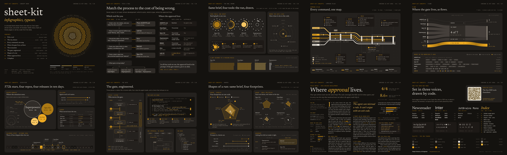

<a id="readme-top"></a>

<div align="center">

# sheet-kit

**Infographic pages, typeset. Data in, a pixel-perfect PDF out.**

Fixed-layout pages in [Typst](https://typst.app): a dark editorial theme,
the marks infographics are built from, and checks that catch what an eye
misses: missing glyphs, ink in the margins, Preview seams, regressions.
Sister of [book-kit](https://github.com/felipefontoura/book-kit), shared the
same way: as a git submodule.

[](https://github.com/felipefontoura/sheet-kit/actions/workflows/ci.yml)
[](LICENSE)
[](https://typst.app)

[View the concept book (PDF)](example/output/sheet-kit-concepts.pdf)
·
[Report Bug](https://github.com/felipefontoura/sheet-kit/issues/new?template=bug_report.yml)
·
[Request Feature](https://github.com/felipefontoura/sheet-kit/issues/new?template=feature_request.yml)



*Real, unretouched output of `bash example/run.sh`.*

</div>

## Table of contents

- [About](#about)
- [Getting started](#getting-started)
- [Writing a page](#writing-a-page)
- [Configuration — sheet.config.json](#configuration--sheetconfigjson)
- [Checks](#checks)
- [Architecture](#architecture)
- [Visual system](#visual-system)
- [Contributing](#contributing)
- [License](#license)
- [Contact](#contact)

## About

A cheatsheet, a one-pager or a data poster is not a document that flows: it
is a page where every mark has a place. Browsers print those pages with
artifacts (shadows become dark slabs in Preview, shapes that touch leave
hairline seams), and design tools don't diff. sheet-kit sets them in Typst,
from data, and checks the result in the renderer readers actually use.

- **One file per page**, compiled alone in milliseconds while you design,
  or all together as one PDF with fonts embedded once.
- **Text that behaves like CSS**: sizes and line heights in px, baselines
  where a browser puts them, so a page drawn in HTML, Figma or Claude Design
  ports with its numbers.
- **Marks for infographics**: tiles, panel heads, badges, arrows, textures,
  glows, flow ribbons and connected rows that join without seams, plus
  [cetz](https://typst.app/universe/package/cetz),
  [fletcher](https://typst.app/universe/package/fletcher) and
  [tiaoma](https://typst.app/universe/package/tiaoma) pinned in one place.
- **Checks on every build**: page size, house fonts only, every character
  in a house font, nothing painted outside the margins, links, and a pixel
  regression against the approved render.
- **Preview's engine on macOS** (`--preview`): renders with CoreGraphics at
  1x, 1.5x and 4x, and scans for the slabs only Preview shows.

The [concept book](example/) is the reference: ten pages that push the kit
(generative cover, metro map, alluvial, packed bubbles, state machine with
highlighted code, radar small multiples, a magazine long-read on a baseline
grid, a colophon with QR and type specimen). It doubles as the CI test.

### Built with

[Typst](https://typst.app) · [cetz](https://github.com/cetz-package/cetz) ·
[fletcher](https://github.com/Jollywatt/typst-fletcher) ·
[tiaoma](https://github.com/Myriad-Dreamin/tiaoma) ·
[MuPDF](https://mupdf.com) · [pngjs](https://github.com/pngjs/pngjs)

<p align="right">(<a href="#readme-top">back to top</a>)</p>

## Getting started

### Prerequisites

- [mise](https://mise.jdx.dev) (installs the pinned Node and Typst from
  `mise.toml`), **or** Node ≥ 22 and Typst 0.15.1 on `PATH`.
- macOS for `--preview` (CoreGraphics); everything else runs anywhere.

### Try it in two minutes

```bash
git clone https://github.com/felipefontoura/sheet-kit.git
cd sheet-kit
mise install
npm ci
bash example/run.sh            # → example/.build/dist/sheet-kit-concepts.pdf
```

### Start your own material

```bash
mkdir my-sheet && cd my-sheet && git init
git submodule add https://github.com/felipefontoura/sheet-kit.git kit
cp kit/example/sheet.config.json .     # then edit every string
mkdir pages && cp kit/example/pages/02-decision.typ pages/01-first.typ
touch data.typ
bash kit/scripts/build.sh              # → dist/<name>.pdf, dist/png/
```

```bash
bash kit/scripts/build.sh --page 01    # one page alone: the fast loop
bash kit/scripts/build.sh --preview    # + Preview-engine renders (macOS)
bash kit/scripts/build.sh --links      # + request every link in the PDF
bash kit/scripts/build.sh --update-ref # accept the render as the reference
git submodule update --remote kit      # pull kit updates later
```

<p align="right">(<a href="#readme-top">back to top</a>)</p>

## Writing a page

```typst
#import "/kit/typst/sheet.typ": *
#import "/data.typ": *

#show: sheet.with(section: "The run")

#headline("Same brief, four tools.", note: "13 Oct 2026 · n = 1 per tool")
#v(16 * px)
#grid(columns: (612 * px, 1fr), column-gutter: 16 * px,
  tile({
    panel-head("Four tools, one brief", "Each glyph is one run.")
    v(14 * px)
    canvas({ import cetz.draw: *; … })
  }),
  tile({ … }),
)
```

- Pages go in `pages/`, in file order. The build lists them; there is no
  index to maintain.
- The running head (label, section, check date, page n / total) is set by
  `sheet`; the label, date and format come from `sheet.config.json`.
- Every number comes from `data.typ`.
- The rules (grid, baselines, joins, glyphs, colour) are in
  [AGENTS.md](AGENTS.md). They are written for coding agents and hold for
  people too.

## Configuration — sheet.config.json

```json
{
  "name": "sheet-kit-concepts",
  "title": "sheet-kit: infographics, typeset",
  "author": "Felipe Fontoura",
  "label": "sheet-kit concepts",
  "checked": "21 Oct 2026",
  "format": "letter-landscape"
}
```

| Key | Use |
|---|---|
| `name` | Output file: `dist/<name>.pdf` |
| `title`, `author` | PDF metadata |
| `label` | Left of the running head on every page |
| `checked` | "Checked <date>" in the running head: when the facts were last verified |
| `format` | `letter-landscape` (default), `letter`, `a4-landscape`, `a4` |

## Checks

| Check | Fails when |
|---|---|
| page size | a page is not the configured format |
| fonts | a face outside Inter, Newsreader, JetBrains Mono is embedded |
| glyphs | a character is missing from the house fonts (found by a second compile with fallback on) |
| safe area | any pixel is painted outside the margins (48 px sides, 32 top, 28 bottom; 2 px for glyph overhang) |
| regression | a page's mean pixel difference from `output/png` exceeds 0.5 (0–255) |
| links | with `--links`: a link answers 4xx/5xx or not at all |
| no Preview slabs | with `--preview`: Preview paints a transparency group darker than the ground |

## Architecture

```
typst/
  sheet.typ      one import for a page; pins cetz, fletcher, tiaoma
  theme.typ      ink, voices, metrics, strokes, space, formats, margin
  type.typ       tx, para, m, sf, ss, lbl, eyebrow, code, nocalt
  layout.typ     sheet, header, headline, tile, panel-head, source, at
  marks.typ      canvas, frame, badge, arrow, hatch, screen, glow, ribbon, connected
  book.typ       entry: includes the generated /.build/pages.typ
  themes/        Base25 dark syntax theme
  assets/fonts/  static instances (scripts/fonts.sh) + OFL
scripts/
  build.sh       pipeline (two roots, like book-kit)
  check.mjs      checks (MuPDF, pngjs)
  preview.swift  CoreGraphics renderer, Preview's engine
  fonts.sh       fonts from google/fonts at a pinned commit, deterministic
example/         the concept book, staged as a material repo by run.sh
```

Two roots: `KIT_ROOT` (this repo, as `kit/`) and `PROJECT_ROOT` (the
material). Typst runs with `--root` at the material, so the kit's entry
reads `/sheet.config.json` and `/.build/pages.typ` from it.

## Visual system

Base25 dark, the identity of [felipefontoura.com](https://felipefontoura.com):
warm charcoal grounds, one amber ramp (amber is a point of light, not paint),
three voices (Newsreader for headings, Inter for body and UI, JetBrains Mono
for labels and data), separation by surface and space instead of rules. The
fonts are instanced at the optical sizes the site renders, so a page set
here and a page in a browser break lines alike.

## Contributing

Open an issue first for anything bigger than a fix. A change to the kit
keeps `bash example/run.sh` green: the regression stays at 0.000, or the PR
says what changed on purpose and carries `--update-ref`.

## License

MIT for the code ([LICENSE](LICENSE)). The fonts are under the SIL Open
Font License (`typst/assets/fonts/OFL-*.txt`).

## Contact

Felipe Fontoura · [felipefontoura.com](https://felipefontoura.com)

<p align="right">(<a href="#readme-top">back to top</a>)</p>
