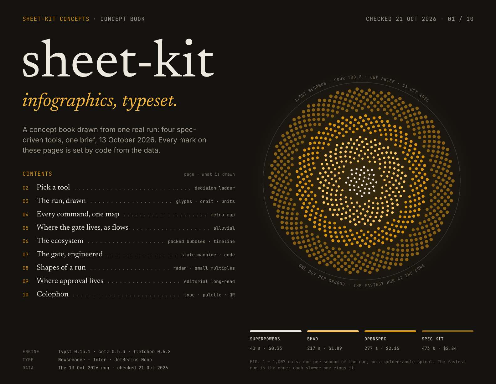
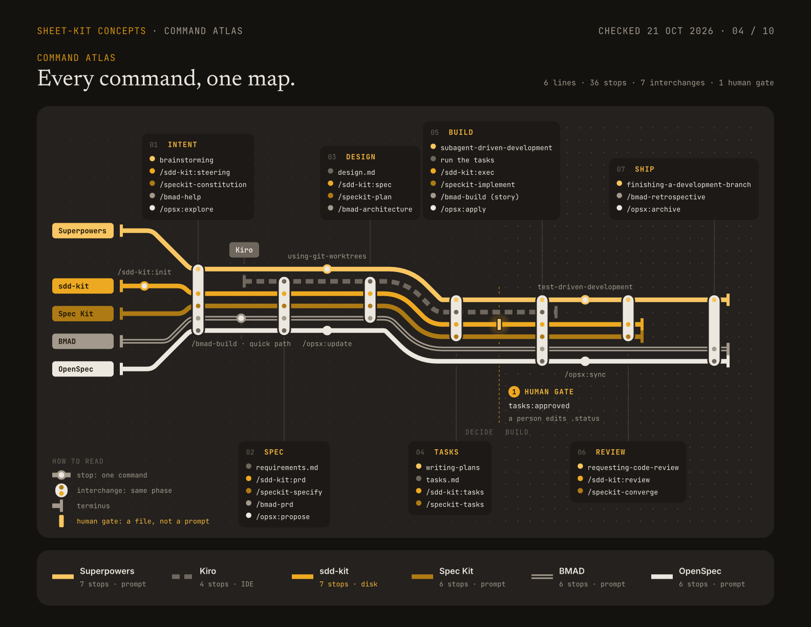

<a id="readme-top"></a>

<div align="center">

# sheet-kit

**Draw a page in Typst. Get a pixel-perfect PDF, page previews, and checks that catch what an eye misses.**

A portable Typst engine for fixed-layout infographic pages (cheatsheets,
one-pagers, data posters) with an editorial dark theme, the marks
infographics are built from, and a build that checks every page — shared
across many materials as a git submodule. Sister of
[book-kit](https://github.com/felipefontoura/book-kit).

[](https://github.com/felipefontoura/sheet-kit/actions/workflows/ci.yml)
[](LICENSE)
[](https://typst.app)
[](https://nodejs.org)

[View sample PDF](example/output/sheet-kit-concepts.pdf)
·
[Report Bug](https://github.com/felipefontoura/sheet-kit/issues/new?template=bug_report.yml)
·
[Request Feature](https://github.com/felipefontoura/sheet-kit/issues/new?template=feature_request.yml)

&nbsp;&nbsp;


*Both images are real, unretouched output of `bash example/run.sh`.*

</div>

## Table of contents

- [About](#about)
- [Getting started](#getting-started)
- [Writing a page](#writing-a-page)
- [Configuration — sheet.config.json](#configuration--sheetconfigjson)
- [Marks](#marks)
- [Checks](#checks)
- [Porting a page from HTML](#porting-a-page-from-html)
- [Architecture](#architecture)
- [Visual system](#visual-system)
- [Roadmap](#roadmap)
- [Contributing](#contributing)
- [License](#license)
- [Contact](#contact)
- [Acknowledgments](#acknowledgments)

## About

A cheatsheet or a data poster is not a document that flows: it is a page
where every mark has a place. Browsers print those pages with artifacts
(blurred shadows become dark slabs in macOS Preview, shapes that only touch
leave hairline seams) and design tools don't diff. This kit was built to
publish real materials and cares about the part those tools skip: **the
exact page**.

One folder per material is the single source of truth: a config, a data
file, one Typst file per page. From it, one command produces:

- **The PDF** — every page in one document, fonts embedded once, the running
  head (label, section, check date, page n / total) set from the config.
- **Page PNGs** — the previews a landing page or an offer card shows,
  rendered from the same build as the PDF.
- **Checks** — page size, house fonts only, every character in a house font
  (a missing glyph is found and named), nothing painted outside the margins,
  links, and a pixel regression against the approved render.
- **Preview renders** (`--preview`, macOS) — the PDF drawn by CoreGraphics,
  the engine Preview uses, at 1x, 1.5x and 4x, with a scan for the slabs only
  Preview shows.

The engine is consumed as a **git submodule**: every material inherits the
same theme, marks, checks and fixes from one place. The only per-material
files are `sheet.config.json`, `data.typ` and `pages/*.typ`.

### Built with

[Typst](https://typst.app) ·
[cetz](https://github.com/cetz-package/cetz) ·
[fletcher](https://github.com/Jollywatt/typst-fletcher) ·
[tiaoma](https://github.com/Myriad-Dreamin/tiaoma) ·
[MuPDF](https://mupdf.com) ·
[pngjs](https://github.com/pngjs/pngjs)

<p align="right">(<a href="#readme-top">back to top</a>)</p>

## Getting started

### Prerequisites

- [mise](https://mise.jdx.dev) (recommended — installs pinned Node + Typst from
  `mise.toml`), **or** Node ≥ 22 and [Typst 0.15.1](https://typst.app/docs/) on `PATH`.
- macOS for `--preview` (CoreGraphics); everything else runs anywhere.

### Try it in two minutes

```bash
git clone https://github.com/felipefontoura/sheet-kit.git
cd sheet-kit
mise install
npm ci
bash example/run.sh      # → example/.build/dist/sheet-kit-concepts.pdf + page PNGs + checks
```

The [concept book](example/pages) is ten pages that push every mark
(generative cover, metro map, alluvial, packed bubbles, state machine with
highlighted code, radar small multiples, a magazine long-read on a baseline
grid, a colophon with QR and type specimen) — it doubles as living
documentation and as the CI test. Don't want to build first? Finished output
is committed at [`example/output/`](example/output)
([PDF](example/output/sheet-kit-concepts.pdf)).

### Start your own material

```bash
mkdir my-sheet && cd my-sheet && git init
git submodule add https://github.com/felipefontoura/sheet-kit.git kit
cp kit/example/sheet.config.json .            # then edit every string
mkdir pages && cp kit/example/pages/02-decision.typ pages/01-first.typ
printf '#let checked = json("/sheet.config.json").checked\n' > data.typ
bash kit/scripts/build.sh                     # run from the material root
```

Pages import the kit as `/kit/typst/sheet.typ`: keep it mounted at `kit/`.
Outputs land in `dist/`.

```bash
bash kit/scripts/build.sh --page 01           # one page alone: the fastest loop
bash kit/scripts/build.sh --pdf               # the PDF only
bash kit/scripts/build.sh --preview           # + Preview-engine renders and slab scan (macOS)
bash kit/scripts/build.sh --links             # + request every link in the PDF
bash kit/scripts/build.sh --update-ref        # accept the current render as the reference
git submodule update --remote kit             # pull engine updates later
```

<p align="right">(<a href="#readme-top">back to top</a>)</p>

## Writing a page

One file per page in `pages/`, in file order (`01-cover.typ`,
`02-decision.typ`…). The build lists them; there is no index to maintain.

```typst
#import "/kit/typst/sheet.typ": *
#import "/data.typ": *

#show: sheet.with(section: "The run")

#headline("Same brief, four tools.", note: "13 Oct 2026 · n = 1 per tool")
#v(16 * px)
#grid(columns: (612 * px, 1fr), column-gutter: 16 * px,
  tile({
    panel-head("Four tools, one brief", "Each glyph is one run.")
    v(14 * px)
    canvas({ import cetz.draw: *; … })
  }),
  tile({ … }),
)
```

- Sizes are CSS px (`* px`, 1 px = 0.75 pt), so a page drawn in HTML, Figma
  or Claude Design ports with its numbers intact.
- Every number comes from `data.typ`; a page never types a figure.
- The rules (grid, baselines, joins, glyphs, colour) and the review loop are
  in [AGENTS.md](AGENTS.md). They are written for coding agents and hold for
  people too.

<p align="right">(<a href="#readme-top">back to top</a>)</p>

## Configuration — sheet.config.json

Every material-specific string lives here — nothing is hardcoded in the
engine. Copy [`example/sheet.config.json`](example/sheet.config.json) and edit.

| Field | Feeds |
|---|---|
| `name` | the output file, `dist/<name>.pdf` |
| `title`, `author` | PDF metadata |
| `label` | the left of the running head on every page |
| `checked` | "Checked <date>" in the running head: when the facts were last verified |
| `format` | `letter-landscape` (default), `letter`, `a4-landscape`, `a4` |

A consumer may add its own keys (a version, a slug, preview mapping); the
kit ignores them.

The kit owns *layout*, the config owns *words*: to change a page's running
head you edit the config, never the Typst.

<p align="right">(<a href="#readme-top">back to top</a>)</p>

## Marks

Everything a page needs comes from one import, `/kit/typst/sheet.typ`.

| Module | What it gives a page |
|---|---|
| `theme.typ` | `ink` (palette), `sans` / `serif` / `mono`, `strokes` (guide, data, emph), `space`, `formats`, `margin` |
| `type.typ` | `tx` and its voices `m`, `sf`, `ss`, `para`, `lbl`, `eyebrow`, `code`, `nocalt`, `base-gap` |
| `layout.typ` | `sheet`, `headline`, `tile`, `panel-head`, `source`, `at` |
| `marks.typ` | `canvas`, `frame`, `badge`, `arrow`, `hatch`, `screen`, `glow`, `tuck`, `ribbon`, `connected` |
| packages | `cetz` 0.5.3, `fletcher` 0.5.8, `tiaoma` 0.3.0, pinned once and re-exported |
| `code-theme` | the Base25 dark syntax theme for `raw` |

`ribbon` and `connected` exist because of Preview: shapes that only touch
leave an antialiasing hairline at 1x–2x zoom, so they overlap by `tuck`.

<p align="right">(<a href="#readme-top">back to top</a>)</p>

## Checks

| Check | Fails when |
|---|---|
| page size | a page is not the configured format |
| fonts | a face outside Inter, Newsreader, JetBrains Mono is embedded |
| glyphs | a character is missing from the house fonts (found by a second compile with fallback on) |
| safe area | any pixel is painted outside the margins (48 px sides, 32 top, 28 bottom; 2 px for glyph overhang) |
| regression | a page's mean pixel difference from `output/png` exceeds 0.5 (0–255) |
| links | with `--links`: a link answers 4xx/5xx or not at all |
| no Preview slabs | with `--preview`: Preview paints a transparency group darker than the ground |

Typst renders the same pixels on macOS and Linux, so the reference made on a
laptop holds in CI.

<p align="right">(<a href="#readme-top">back to top</a>)</p>

## Porting a page from HTML

A page designed in HTML (or exported from Claude Design) ports 1:1: CSS
`font-size` and `line-height` become `tx(size:, lh:)`, widths, paddings and
gaps keep their px. Three browser habits need help, and
[AGENTS.md](AGENTS.md) explains each: Chrome rounds font metrics (inline mono
in a sans line takes the sans line box), breaks lines greedily
(`linebreaks: "simple"`, straight quotes), and `text-wrap: pretty` moves last
lines (break those by hand). Render both at 2x with Preview's engine and
overlay them until the text sits on itself.

<p align="right">(<a href="#readme-top">back to top</a>)</p>

## Architecture

```text
your-material/                 ← the material repo (content + one config)
├── sheet.config.json          ← every material-specific string
├── data.typ                   ← every fact and number
├── pages/                     ← 01-*.typ, 02-*.typ … one per page
├── output/                    ← the approved PDF + png/ (the regression reference)
├── .build/ · dist/            ← GENERATED (gitignore them)
└── kit/                       ← this repo, as a git submodule
    ├── scripts/               build.sh · check.mjs · preview.swift · fonts.sh
    ├── typst/                 sheet.typ · theme · type · layout · marks · book.typ · themes/
    └── typst/assets/fonts/    Newsreader · Inter · JetBrains Mono (bundled, OFL)
```

Two roots keep the engine portable (`scripts/build.sh`):

- **`KIT_ROOT`** — the engine. Read-only: Typst modules, fonts, scripts,
  `node_modules`.
- **`PROJECT_ROOT`** — the material being built. Holds the config, data and
  pages, and receives every generated output. Resolved as `$PROJECT_ROOT` →
  the current dir if it has a `sheet.config.json` → else the kit itself
  (single-repo mode).

Typst compiles with `--root PROJECT_ROOT`. The build writes
`.build/pages.typ` (an `#include` per page) and copies the kit's entry,
`book.typ`, next to it, so the entry always sits inside the root, even when
`kit/` is a symlink in a monorepo of materials.

The pipeline: `pages/*.typ` → `.build/pages.typ` → `typst compile` → PDF and
page PNGs → a second compile with font fallback on → `check.mjs` (MuPDF for
pages, fonts and links; pngjs for margins and regression) → on macOS,
`preview.swift` (CoreGraphics renders) → slab scan.

<p align="right">(<a href="#readme-top">back to top</a>)</p>

## Visual system

The visual identity: warm charcoal + amber, three type voices, and
separation by surface instead of borders — the identity of
[felipefontoura.com](https://felipefontoura.com/?utm_source=github&utm_medium=referral&utm_campaign=sheet-kit&utm_content=readme).

| Voice | Family | Used for |
|---|---|---|
| Serif (display) | Newsreader 400/500/600 | headlines, panel titles, pull quotes |
| Sans (body) | Inter 400/500/600/700 | body text, labels inside charts, captions |
| Mono (labels) | JetBrains Mono 400/500/700 | running heads, kickers, data, code — caps with tracking for labels |

Pages are dark: ground `#14120F`, cards `#24211E`, paper ink `#ECE7DF`, one
amber ramp from `#FDF6E7` to `#5B4415`. Amber is a point of light, not
paint: one hero element per page carries it, the rest is paper, greys and
textures. The fonts are instanced at the optical sizes the site renders
(Inter 14, Newsreader 16), so a page set here and a page in a browser break
lines alike.

Design tokens intentionally live in the kit (`typst/theme.typ`) — they are
the shared identity of a series of materials, not per-material copy.

<p align="right">(<a href="#readme-top">back to top</a>)</p>

## Roadmap

- [ ] A light theme for print-first materials
- [ ] A check for hairline seams (today: the `tuck` rule plus review at 1x–1.5x)
- [ ] Portrait formats in the concept book
- [ ] Built-in chart helpers (bars, dot matrix, donut) promoted from the example pages

See [open issues](https://github.com/felipefontoura/sheet-kit/issues)
for the full list.

## Contributing

Contributions are welcome — see [CONTRIBUTING.md](CONTRIBUTING.md) for setup,
the verification checklist (build the example, *look at the output*), and the
design rules that keep the engine portable. This project follows a
[Code of Conduct](CODE_OF_CONDUCT.md).

## License

Code is distributed under the **MIT License** — see [LICENSE](LICENSE).
The bundled fonts are under the **SIL Open Font License 1.1** — see
[typst/assets/fonts/LICENSE.md](typst/assets/fonts/LICENSE.md).

## Contact

Felipe Fontoura — [felipefontoura.com](https://felipefontoura.com/?utm_source=github&utm_medium=referral&utm_campaign=sheet-kit&utm_content=readme) ·
[Contact](https://felipefontoura.com/contact/?utm_source=github&utm_medium=referral&utm_campaign=sheet-kit&utm_content=readme) ·
[@felipefontoura](https://github.com/felipefontoura)

## Acknowledgments

- [Typst](https://typst.app) for making programmable typography sane
- [cetz](https://github.com/cetz-package/cetz), [fletcher](https://github.com/Jollywatt/typst-fletcher)
  and [tiaoma](https://github.com/Myriad-Dreamin/tiaoma) for drawing, diagrams and QR codes in Typst
- [Rasmus Andersson](https://rsms.me/inter/) (Inter),
  [JetBrains](https://www.jetbrains.com/lp/mono/) (JetBrains Mono) and
  [Production Type](https://github.com/productiontype/Newsreader) (Newsreader)
- [Nadieh Bremer](https://www.visualcinnamon.com/) and the
  [Information is Beautiful Awards](https://www.informationisbeautifulawards.com/)
  for setting the bar the concept book reaches for
- [Best-README-Template](https://github.com/othneildrew/Best-README-Template)
  for the shape of this file

<p align="right">(<a href="#readme-top">back to top</a>)</p>
